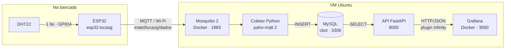
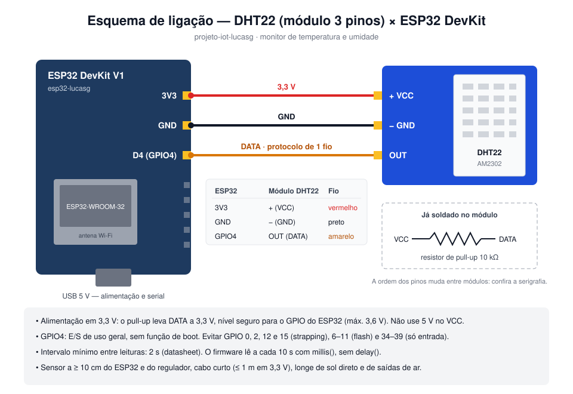

# Monitor de temperatura e umidade — `projeto-iot-lucasg`

Projeto IoT do CTIoT: um **DHT22** ligado a um **ESP32** mede temperatura e umidade de um ambiente, publica por **MQTT**, um **coletor Python** valida e grava no **MySQL**, uma **API FastAPI** disponibiliza os dados e um dashboard no **Grafana** mostra tudo em tempo real e no histórico.

| Item | Valor |
|------|-------|
| Aluno (id) | `lucasg` |
| Dispositivo / client ID | `esp32-lucasg` |
| Projeto | `temperatura` |
| Tópico de dados | `inatel/lucasg/dados` (a cada 10 s, não retido) |
| Tópico de status | `inatel/lucasg/status` (`online` / `offline`, retido, Last Will) |
| Usuários do broker | `esp-lucasg`, `leitor-lucasg`, `admin-lucasg` |

---

## Sumário

1. [Arquitetura](#1-arquitetura)
2. [Materiais](#2-materiais)
3. [Esquema de ligação](#3-esquema-de-ligação)
4. [Características do DHT22](#4-características-do-dht22)
5. [Estrutura do repositório](#5-estrutura-do-repositório)
6. [Como executar](#6-como-executar)
7. [Decisões técnicas](#7-decisões-técnicas)
8. [Testes](#8-testes)
9. [Dificuldades](#9-dificuldades)
10. [Marcos](#10-marcos)

---

## 1. Arquitetura



**Payload** publicado em `inatel/lucasg/dados`:

```json
{
  "dispositivo": "esp32-lucasg",
  "projeto": "temperatura",
  "leituras": { "temperatura": 24.6, "umidade": 58.2 }
}
```

| Camada | Responsabilidade | Onde roda |
|--------|------------------|-----------|
| Firmware | Medir e publicar | ESP32 |
| Broker | Entregar mensagens | Container Docker na VM |
| Coletor | Validar e guardar | VM (Python + venv) |
| MySQL | Lembrar o histórico | VM |
| API | Responder perguntas sobre os dados | VM (Uvicorn) |
| Grafana | Mostrar | Container Docker na VM |

## 2. Materiais

| Qtd. | Item | Observação |
|------|------|------------|
| 1 | ESP32 DevKit V1 (ESP32-WROOM-32) | Alimentado pela USB |
| 1 | Módulo DHT22 (AM2302) de 3 pinos | Já tem resistor de pull-up de 10 kΩ |
| 3 | Jumpers fêmea-fêmea (ou macho-fêmea + protoboard) | Vermelho, preto e amarelo |
| 1 | Cabo USB de dados | Alimentação e monitor serial |
| 1 | VM Ubuntu com Docker, Python 3 e MySQL | Broker, coletor, banco, API e Grafana |

## 3. Esquema de ligação



| ESP32 | Módulo DHT22 | Fio |
|-------|--------------|-----|
| 3V3 | `+` (VCC) | vermelho |
| GND | `−` (GND) | preto |
| GPIO4 (D4) | `OUT` (DATA) | amarelo |

> A ordem dos pinos muda de um módulo para outro: confira a serigrafia da sua placa antes de ligar.

**Justificativas**

- **Alimentação em 3,3 V.** O DHT22 funciona de 3,3 a 6 V. Alimentado pelo 3V3 do ESP32, o pull-up leva a linha DATA a 3,3 V, que é o nível seguro para o GPIO do ESP32 (ele **não** tolera 5 V). Alimentar com 5 V colocaria 5 V no pino de dados.
- **Pull-up.** O protocolo de um fio é dreno aberto: precisa de um resistor de pull-up entre VCC e DATA. O módulo de 3 pinos **já tem** um de 10 kΩ, então nenhum componente extra é necessário. (Com o sensor de 4 pinos solto seria preciso adicionar um.)
- **GPIO4.** Pino de E/S de uso geral, bidirecional, sem função no boot. Evitados: GPIO 0, 2, 12 e 15 (strapping), 6 a 11 (memória flash) e 34 a 39 (só entrada).
- **Frequência de leitura.** O DHT22 aceita no máximo uma leitura a cada 2 s; lendo mais rápido ele devolve o valor anterior ou falha (`NaN`). O firmware lê a cada 10 s, controlado por `millis()`, sem `delay()`.
- **Biblioteca.** `adafruit/DHT sensor library` (+ `Adafruit Unified Sensor`), que implementa o protocolo de temporização e devolve `NaN` em caso de falha.
- **Instalação.** Sensor a pelo menos 10 cm do ESP32 e do regulador de tensão (que esquentam), com cabo curto (≤ 1 m em 3,3 V), longe de sol direto e de saídas de ar, de preferência com o sensor na vertical e abaixo da placa.

## 4. Características do DHT22

Valores do datasheet do AM2302/DHT22 — conferir com o datasheet do seu módulo.

| Característica | Valor |
|----------------|-------|
| Alimentação | 3,3 a 6 V DC |
| Consumo | ~1 a 1,5 mA medindo; 40 a 50 µA em espera |
| Sinal | Digital, protocolo próprio de 1 fio (40 bits) |
| Faixa de temperatura | −40 a 80 °C |
| Exatidão de temperatura | ±0,5 °C |
| Resolução de temperatura | 0,1 °C |
| Faixa de umidade | 0 a 100 % UR |
| Exatidão de umidade | ±2 % UR (máx. ±5 %) |
| Resolução de umidade | 0,1 % UR |
| Intervalo mínimo entre leituras | 2 s |

**Resolução × exatidão:** a resolução (0,1 °C) é o menor passo que o sensor consegue mostrar; a exatidão (±0,5 °C) é o quanto o valor mostrado pode estar longe do valor real. Uma leitura de 24,6 °C significa "entre 24,1 e 25,1 °C".

**Faixas usadas pelo coletor para descartar leituras:** temperatura −40 a 80 °C; umidade 0 a 100 %.

## 5. Estrutura do repositório

```
projeto-iot-lucasg/
├── firmware/                  ← projeto PlatformIO do ESP32
│   ├── platformio.ini
│   ├── src/main.cpp
│   └── include/secrets.example.h
├── broker/                    ← Mosquitto 2 em Docker
│   ├── docker-compose.yml
│   ├── mosquitto.conf
│   ├── acl                    ← permissões de cada usuário
│   └── passwd.example         ← lista dos usuários, sem senhas
├── banco/
│   ├── schema.sql             ← criação das tabelas
│   └── consultas.sql          ← consultas usadas e testadas
├── servidor/
│   ├── db.py                  ← conexão com o banco
│   ├── coletor.py             ← subscriber MQTT que grava no banco
│   ├── api.py                 ← API FastAPI
│   ├── requirements.txt
│   └── .env.example
├── grafana/                   ← Grafana em Docker
│   ├── docker-compose.yml
│   ├── .env.example
│   └── dashboard.json         ← dashboard exportado
├── docs/
│   ├── esquema-ligacao.svg
│   ├── plano-de-testes.md
│   ├── fotos/                 ← foto do dispositivo montado
│   ├── prints/                ← prints do dashboard
│   └── evidencias/            ← logs e prints dos testes
├── .gitignore
└── README.md
```

Ficam **fora do Git** (ver `.gitignore`): `firmware/include/secrets.h`, `servidor/.env`, `grafana/.env`, `broker/passwd`, `broker/data/`, `broker/log/`.

## 6. Como executar

### 6.1 Firmware (ESP32)

```bash
cd firmware
cp include/secrets.example.h include/secrets.h   # preencher Wi-Fi e MQTT
pio run -t upload
pio device monitor
```

### 6.2 Broker (VM)

```bash
sudo systemctl disable --now mosquitto           # desativa o Mosquitto da VM
cd broker
touch passwd                                     # criar antes de subir
docker compose up -d
docker compose exec mosquitto mosquitto_passwd -c /mosquitto/config/passwd esp-lucasg
docker compose exec mosquitto mosquitto_passwd    /mosquitto/config/passwd leitor-lucasg
docker compose exec mosquitto mosquitto_passwd    /mosquitto/config/passwd admin-lucasg
docker compose restart
```

Conferir: `mosquitto_sub -h <ip-da-vm> -u admin-lucasg -P <senha> -t 'inatel/lucasg/#' -v`

### 6.3 Banco de dados (VM)

```bash
sudo mysql < banco/schema.sql    # ver comentários no topo do arquivo (banco e usuário)
```

### 6.4 Coletor e API (VM)

```bash
cd servidor
python3 -m venv .venv && source .venv/bin/activate
pip install -r requirements.txt
cp .env.example .env              # preencher senhas
python coletor.py                 # terminal 1
uvicorn api:app --host 0.0.0.0 --port 8000   # terminal 2
```

Documentação da API: `http://<ip-da-vm>:8000/docs`

| Endpoint | Uso no Grafana |
|----------|----------------|
| `GET /api/dispositivos` | Conferência |
| `GET /api/dispositivos/{nome}/ultima` | Valores atuais e "sem dados" (`idade_s`) |
| `GET /api/dispositivos/{nome}/leituras?grandeza=...&horas=24` | Gráficos históricos |
| `GET /api/dispositivos/{nome}/resumo?horas=24` | Mínimo, máximo e média |

### 6.5 Grafana (VM)

```bash
cd grafana
cp .env.example .env              # trocar a senha do admin
docker compose up -d
```

Abrir `http://<ip-da-vm>:3000`, criar a fonte de dados Infinity apontando para `http://host.docker.internal:8000` e importar `dashboard.json`.

## 7. Decisões técnicas

| Decisão | Motivo |
|---------|--------|
| DHT22 em vez de DHT11 | Faixa maior (−40 a 80 °C, 0 a 100 %), exatidão melhor (±0,5 °C / ±2 %) e resolução de 0,1 |
| Módulo de 3 pinos | Pull-up já incluso: menos fiação e menos pontos de falha |
| Alimentação em 3,3 V | Nível do sinal de dados compatível com o ESP32 sem divisor de tensão |
| GPIO4 | Uso geral, sem função de boot |
| Leitura a cada 10 s com `millis()` | Respeita o mínimo de 2 s do sensor e não trava o `loop()` (MQTT continua sendo atendido) |
| Last Will retido em `status` | O broker publica `offline` se o ESP cair; quem assina depois já recebe o último estado |
| Horário registrado pelo servidor | O ESP32 não tem relógio confiável |
| TODO | Demais decisões (ACL, validação, consultas, painéis) |

## 8. Testes

O plano completo, com resultados e evidências, está em [`docs/plano-de-testes.md`](docs/plano-de-testes.md).

## 9. Dificuldades

<!-- TODO: registrar os problemas encontrados e como foram resolvidos -->

## 10. Marcos

- [ ] **M1** — ESP publica o JSON a cada 10 s e o status com Last Will
- [ ] **M2** — Broker protegido em container; coletor aceita e descarta corretamente
- [ ] **M3** — Leituras gravadas e consultas com dados reais
- [ ] **M4** — Quatro endpoints pela rede
- [ ] **M5** — Grafana com valores, "sem dados", dois gráficos e resumo
- [ ] **M6** — Testes executados, README completo e apresentação

**Opcionais** (depois do obrigatório): índice de calor · ponto de orvalho (Magnus, a = 17,62, b = 243,12 °C) · alerta de faixa de temperatura · coletor e API como serviços do systemd · TLS no broker.
